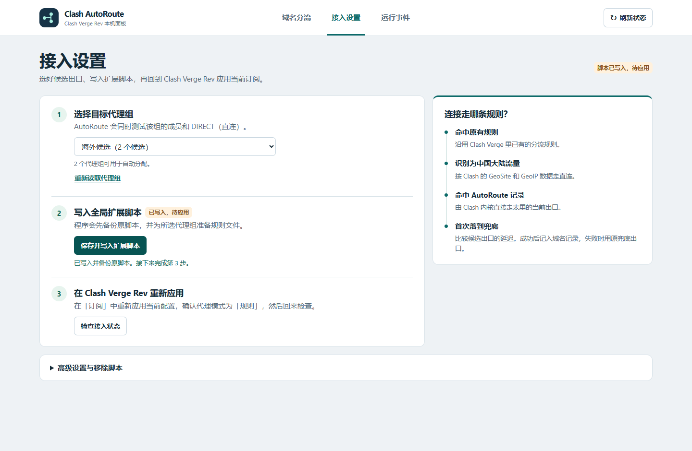
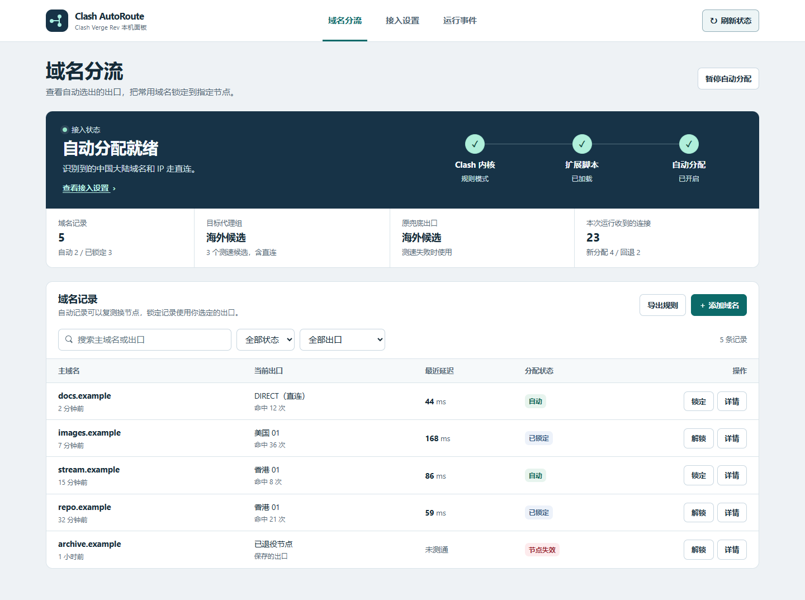
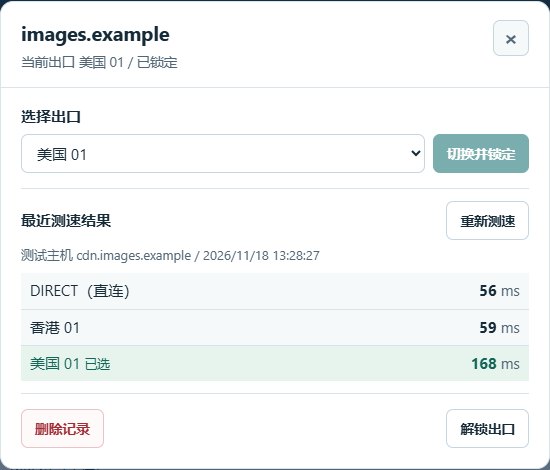
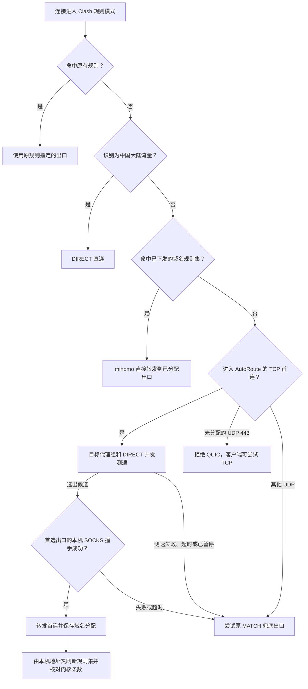

# Clash AutoRoute

Clash AutoRoute 给 **Windows 上的 Clash Verge Rev（mihomo）** 增加按域名自动选出口的能力。原有分流规则仍优先。未命中原规则的中国大陆流量按 Clash 的 GEO 数据走直连，其余落到兜底的域名会在所选代理组和 `DIRECT` 之间并发测速并分配出口。

刚开始用时，先完成「接入设置」的三步。面板显示 **自动分配就绪** 后，再打开一个走兜底规则的网站验证。

[墨间的项目页](https://alioth-mojian-20261116.aliothchen.chatgpt.site/#clash-autoroute)

## 第一次使用

### 1. 启动本机面板

需要 Windows、Node.js **20 或以上**，以及正在运行、已应用订阅的 Clash Verge Rev。在 PowerShell 下载源码并安装依赖。

```powershell
git clone https://github.com/AliothChen555-star/clash-autoroute.git
Set-Location clash-autoroute
npm.cmd ci
```

也可以从 [GitHub 仓库](https://github.com/AliothChen555-star/clash-autoroute) 选择 **Code → Download ZIP**，解压后在项目目录运行 `npm.cmd ci`。

双击 `start.bat`，打开 [本机面板](http://127.0.0.1:7898/)。浏览器如果先于服务打开，等启动窗口出现面板地址后再刷新。平时可双击 `start-silent.vbs` 后台启动，通过 Windows 托盘图标打开面板。也可以直接运行 `npm.cmd start`。

### 2. 在「接入设置」写入脚本

已经接入的用户更新程序后请重启 AutoRoute。面板显示「测速候选，含直连」时，当前脚本已有直连出口。如果没有，需要重新写入脚本并在 Clash Verge Rev 重新应用当前订阅。

1. 选择 **目标代理组**。该组的显式成员会和 `DIRECT` 一起参加测速。第一次可以选成员较少、平时熟悉的组。
2. 点击 **保存并写入扩展脚本**。程序会将原脚本备份到 `data/backup/`，并预建选中组所需的规则文件。界面显示「脚本已写入，待应用」时，继续下一步。
3. 回到 Clash Verge Rev，在 **订阅** 页面重新应用当前订阅，确认代理模式为 **规则**。再回到面板点击 **检查接入状态**。



如果某个组显示「无可用显式成员」，可以选择一个在 mihomo 的 `proxies` 列表中写明成员的代理组。通过 `use`、`include-all` 等选项动态加入的成员不会单独成为 AutoRoute 候选。请选择在全局脚本执行时已经存在、且成员与最终运行配置一致的组。Clash Verge Rev 会在全局脚本之后运行订阅扩展。 [Clash Verge Rev 扩展配置与脚本](https://www.clashverge.dev/guide/extend.html) · [mihomo 代理组配置](https://wiki.metacubex.one/en/config/proxy-groups/)

### 3. 验证第一条记录

1. 在「域名分流」确认显示 **自动分配就绪**。
2. 用一个流量确实经过 Clash 的应用打开网站。选择尚无 AutoRoute 记录、并且会落到 `MATCH` 兜底的域名。可以用 Clash Verge Rev 的「连接」页面查看命中的规则。命中大陆直连的流量由 mihomo 处理，可在连接详情里查看 `AutoRoute-Direct` 和 `DIRECT`。
3. 测速成功后，在面板搜索该主域名。比如访问 `cdn.example.com`，记录会归到 `example.com`。截图里的域名、节点和延迟是演示数据。



## 日常怎么用

| 想做什么 | 在哪里操作 | 会发生什么 |
| --- | --- | --- |
| 让程序继续挑出口 | 域名保持为「自动」，或点击 **解锁** | 近期使用的自动记录会连同直连一起复测，并在延迟改善达到阈值时切换。之前没有把直连纳入选路的活跃自动记录也会分批重测。 |
| 固定当前出口 | 点列表里的 **锁定** | 保留该出口，复测可更新延迟。 |
| 手动指定其他出口 | 打开 **详情**，选择出口后点 **切换并锁定** | 新出口写入规则集，记录进入锁定状态。 |
| 手动加一个域名 | 点 **添加域名**，选出口后点 **添加并锁定** | 子域名会归并到主域名。已有记录从该行的「详情」修改。 |
| 比较代理和直连 | **详情** → **重新测速** | 同时比较可用的代理和 `DIRECT（直连）`。自动记录用本轮测得更快的出口，锁定记录保留当前出口。 |
| 为指定域名固定直连 | **添加域名** 或 **详情**，选择 **DIRECT（直连）** 并锁定 | 为该主域名写入直连分配，原有规则仍优先。节点端口范围有空位时，面板会额外提供直连选项。 |
| 跳过某个域名的自动分流 | **接入设置** → **高级设置与移除脚本** → **排除域名** | 归并后的主域名退出 AutoRoute 规则集和导出范围，原记录保留。新连接按其余规则匹配。 |
| 暂时停止自动分配 | 首页或托盘的 **暂停自动分配** | 落到兜底的新域名使用原出口，原有规则、已下发规则和大陆直连照常匹配。 |



「节点失效」表示保存的出口不在当前 AutoRoute 候选中。打开详情换一个出口即可保留该域名的锁定记录。列表的延迟是采样主机 HTTP/HTTPS 请求的测量值，命中数来自定期读取的连接快照。

## 导出规则 YAML

点 **域名记录 → 导出规则**，可以 **下载 YAML**，也可以 **保存至项目目录**，将文件写入 `data/exports/`。需要导出自动记录时，先锁定相应域名，或在导出窗口点 **批量锁定**，锁定当前可用的自动记录。

导出文件包含当前运行配置的原有 `rule-providers` 和 `rules`、可引用的锁定域名规则，以及还原后的原 `MATCH`。新增规则插入到首条兜底之前，保留原有规则相对顺序。已排除的域名、自动记录、在运行配置中已不存在的出口和无法写入规则的出口名会被略过。导出结果用于合并到有对应代理节点、代理组和 provider 文件的 Clash 配置中。

## 连接如何选路

默认启用中国大陆直连。首条 `MATCH` 前的原有规则优先，接着由 mihomo 使用可用的 `GEOSITE,cn` 和 `GEOIP,CN` 识别大陆域名和目标 IP。命中的连接直接转发，已有 AutoRoute 记录也不会盖过这两条规则。其余连接继续使用域名记录或测速。GeoIP 判断在需要时使用 mihomo 配置的 DNS 解析目标域名。[mihomo 路由规则](https://wiki.metacubex.one/en/config/rules/) · [GEO 数据配置](https://wiki.metacubex.one/en/config/general/#geo-data-mode)



测速范围是采样主机的网页根地址，HTTP 用于端口 80，其余使用 HTTPS。若目标组有两个代理，直连出口加载后，这三个候选一起测速。同一主域名的并发首连共用一轮测速，最多等待 3.5 秒选出口，剩余结果随后补齐。首选的本机 SOCKS 握手成功才保存分配，目标网站的连接由 mihomo 随后建立。每次本机握手最多等 0.5 秒。首选握手失败时，原 `MATCH` 兜底只处理本次连接，下次仍可测速。

AutoRoute 把生成的规则保存在本机，mihomo 从 `127.0.0.1` 读取，再回报实际加载的条数。Clash Verge 服务模式使用独立的运行目录，本机规则地址让它在热刷新时也能读到最新版。已加载的规则可匹配同主域名的 TCP 和 UDP，UDP 能否转发还取决于所选出口的能力。手动重测优先于同域名正在进行的后台复测。锁定记录重测时只更新测速数据。 [Clash Verge 服务模式资源处理](https://github.com/clash-verge-rev/clash-verge-rev/blob/v2.5.10/src-tauri/src/core/runtime_bundle.rs#L191-L257) · [mihomo 规则集配置](https://wiki.metacubex.one/en/config/rule-providers/)

## 排查与撤销

| 面板现象 | 接下来怎么做 |
| --- | --- |
| 等待 Clash 内核 | 打开 Clash Verge Rev，应用一个订阅，再刷新面板。默认通过 Windows 命名管道连接。 |
| 脚本已写入，待应用 | 在 Clash Verge Rev 重新应用当前订阅，再点「检查接入状态」。换订阅或代理组成员变化时，脚本会跳过注入。等新订阅应用成功后，重新读取代理组并写入脚本，再应用一次。 |
| 等待规则模式 | 在 Clash Verge Rev 将代理模式切到「规则」，然后刷新。 |
| 兜底规则未接入 | 检查订阅扩展是否改写了首条 `MATCH` 兜底规则，重新应用订阅后再检查。 |
| 等待自动分配接管 | 等待下一次 Clash 健康检查，再刷新确认兜底组已选择 AutoRoute。 |
| 大陆直连规则未加载或仅按一种方式识别 | 确认 Clash 数据目录有 `geosite.dat` 和当前 GeoIP 模式对应的 `Country.mmdb` 或 `geoip.dat`，然后重新写入脚本并应用订阅。缺少其中一个文件时，程序只加载有数据的规则。 |
| 自动测速缺少 `DIRECT` | 确认 `listenerRange` 比目标组的显式代理成员数至少多 1 个，或目标组已列出 `DIRECT`。重新写入脚本、应用订阅后，在面板确认候选包含直连。 |
| 分流就绪但列表为空 | 确认应用流量确实进入 Clash，且域名落到原兜底规则。查看「运行事件」是否有测速失败。 |
| 规则集同步失败 | 面板会显示刷新错误或内核实际加载的条数。服务每 6 秒核对并重试，也可以点「刷新状态」立即检查。服务模式下从旧版升级时，在接入设置重新写入扩展脚本，再到 Clash Verge 重新应用当前订阅。 |
| 想撤销接入 | 在高级设置点 **移除扩展脚本**，然后回到 Clash Verge Rev 重新应用订阅。 |

托盘的「退出 Clash AutoRoute」会关闭本地服务。Clash 要等健康检查切回原兜底出口，已加载的域名规则和 QUIC 规则会留在运行配置中。要恢复接入前的规则顺序，请移除脚本并重新应用订阅。

## 常用配置

首次运行生成 `data/config.json`。面板可配置目标代理组、排除域名和登录 Windows 后自动启动。下面的端口、测速阈值等需要编辑 JSON。编辑后重启 AutoRoute。若更改面板、Hook 或节点专用端口，还需要重新写入脚本并重新应用订阅。

| 配置项 | 默认值 | 作用 |
| --- | --- | --- |
| `targetGroup` | 首个含可用显式成员的组 | 指定参与自动选路的代理组。 |
| `directChina` | `true` | 以 Clash 已有的 GEO 数据补充中国大陆直连规则。设为 `false` 后重启、重写脚本并重新应用订阅可关闭这两条补充规则。 |
| `panelPort` / `hookPort` | `7898` / `7899` | 本机面板端口与接收 TCP 首连的 SOCKS5 端口。 |
| `listenerBase` / `listenerRange` | `7900` / `999` | 原出口的 SOCKS5 端口，以及其后预留给节点使用的端口数。 |
| `probeTimeoutMs` / `raceGraceMs` | `3000` / `60` | 单节点测速超时和首个成功结果后的竞速等待时间，单位为毫秒。 |
| `switchThreshold` / `switchMinDiffMs` | `0.2` / `30` | 后台自动切换要求改善超过 20%，且至少快 30 毫秒。 |
| `retestHours` / `expireDays` | `24` / `30` | 近期活跃的自动记录的复测间隔，以及长期未使用的自动记录的清理天数。 |
| `exclude` | `[]` | 跳过 AutoRoute 分配与下发的主域名列表。 |
| `controller` | `"auto"` | 自动发现 Clash Verge Rev 命名管道，也可配置 HTTP 控制地址。 |

## 开发与验证

```powershell
npm.cmd test
```

测试覆盖脚本注入和大陆直连优先级、三路并行测速、首选握手失败后的原出口回退、规则集回读和重试、复测结果的提交顺序以及 YAML 导出。用独立 mihomo 做端到端验收时，通过新连接的 `rulePayload` 核对实际命中的规则集。改动界面、行为或配置时，在同一批变更中同步维护本文件和 [AGENTS.md](AGENTS.md)。

## 许可证

Clash AutoRoute 采用 [MIT 许可证](LICENSE)。可以在 [GitHub Issues](https://github.com/AliothChen555-star/clash-autoroute/issues) 报告问题。分享日志或配置片段前，请移除订阅链接、密钥、个人域名和访问记录。
